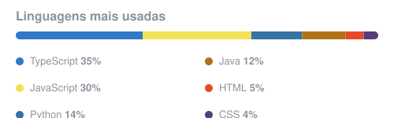

# Lucas Rocha

**Desenvolvedor Web · JavaScript · TypeScript · React · Next.js**
Estudante de Análise e Desenvolvimento de Sistemas · 📍 Campina Grande, PB — Brasil

🎯 **Em busca de estágio ou vaga júnior em desenvolvimento de software**

Graduando em ADS pela **Uninassau**, desenvolvo aplicações **Full Stack** com **JavaScript/TypeScript**, **React** e **Next.js**, além de **APIs** e bancos de dados **MySQL**. Tenho experiência com **POO**, **CRUD** e análise de dados com Python, e uso **Git e GitHub** no dia a dia. Quero aplicar meus conhecimentos em projetos reais e crescer junto com a equipe.

---

## Stack

**Back-end**

**Front-end**

**Ferramentas**

**Banco de dados**

---

## Projetos

| Projeto | Descrição | Tecnologias |
|---|---|---|
| [SistemaCRUD](https://github.com/lucaspy2215/SistemaCRUD) | CRUD com banco de dados e POO | Java |
| [ApiChuva São João](https://github.com/lucaspy2215/ApiChuvaS-oJo-o) | API com dados de chuva dos últimos 10 anos em Campina Grande | Python |
| [Análise IPCA](https://github.com/lucaspy2215/analise-ipca-python) | Análise de dados econômicos do IPCA | Python |

---

## Linguagens mais usadas

---

## Formação

**Análise e Desenvolvimento de Sistemas** — Uninassau, Campina Grande/PB · Previsão: 12/2027
**Idiomas:** Inglês (intermediário)

---

## Contato

